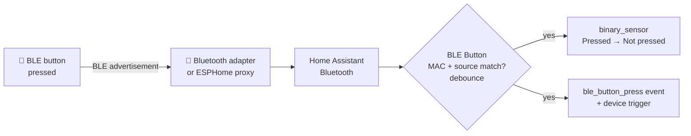

<div align="center">


# BLE Button for Home Assistant

**Turn any cheap Bluetooth LE button into an instant, local Home Assistant trigger.**<br>
Single, double, triple and long press. No pairing. No GATT connection. No cloud.

[](https://hacs.xyz/docs/faq/custom_repositories)
[](https://github.com/albert-canfield/ble_button/releases)
[](https://www.home-assistant.io/)
[](https://github.com/albert-canfield/ble_button/actions/workflows/validate.yml)
[](LICENSE)

[](https://my.home-assistant.io/redirect/hacs_repository/?owner=albert-canfield&repository=ble_button&category=integration)

<br>


</div>

---

## Why BLE Button?

Plenty of inexpensive Bluetooth buttons (Aqara and friends) **broadcast an advertisement every time they are pressed**, but many have no Home Assistant integration, or need a vendor hub to work.

BLE Button listens for those broadcasts through the Bluetooth stack Home Assistant already has, so **every adapter and ESPHome Bluetooth proxy in your home becomes a receiver**. Each button works either as an **instant trigger** or as a **multi-click button** with single, double, triple and long press, so one button can drive several actions.

| | |
|---|---|
| 🔌 **Zero pairing** | Passive listening only. The button is never connected to, so its battery lasts as long as it would on its own. |
| 📡 **Uses your existing Bluetooth** | Local adapters, ESPHome and other Bluetooth proxies. Optionally lock a button to one specific proxy. |
| ⚡ **Instant mode** | Every press fires immediately, as fast as the advertisement arrives. |
| 👆 **Multi-click mode** | **Single, double, triple and long press** from one button, with brand-independent detection. |
| 🧩 **Native Home Assistant entities** | Binary sensor (**Pressed / Not pressed**) or event entity, **Last pressed**, signal strength, device triggers for every click type, and diagnostics download. |
| 🔍 **Point-and-press setup** | Press the button during setup and pick it from a live list of nearby advertisements. No MAC hunting needed. |
| 🛡️ **Debounced** | Duplicate advertisements from the same press (and from several proxies hearing it) count once. |

## Two modes: pick per button

| | ⚡ **Instant** | 👆 **Multi-click** |
|---|---|---|
| Best for | One action per button, fastest response | Several actions on one button |
| The button entity | `binary_sensor.desk_button`: **Pressed** for 0.6 s on every press | `event.desk_button`: **Single click**, **Double click**, **Triple click** or **Long press** |
| Device triggers | *Button pressed* | *Single click*, *Double click*, *Triple click*, *Long press* |
| Bus event | `ble_button_press` | `ble_button_click` (plus `ble_button_press` per press) |
| Speed | Immediate | Clicks are reported once the button has been quiet for the multi-click window (2 s by default); a long press fires while you are still holding |

You choose the mode when adding a button and can switch it any time under **Configure**. Buttons added before 3.0 stay in instant mode.

Every button also gets:

| Entity | Example ID | What it does |
|---|---|---|
| Last pressed | `sensor.desk_button_last_pressed` | Timestamp of the last press. Kept across restarts. |
| Signal strength | `sensor.desk_button_signal_strength` | RSSI of the last advertisement, in dBm. Diagnostic, **disabled by default**. |

Plus **Download diagnostics** (listener counters and last-seen details) on the device page.

## Installation

### HACS (recommended)

Click the button below. It opens HACS on your Home Assistant with this repository pre-filled:

[](https://my.home-assistant.io/redirect/hacs_repository/?owner=albert-canfield&repository=ble_button&category=integration)

Or add it by hand:

1. Open **HACS** in Home Assistant.
2. Open the **⋮** menu (top right) → **Custom repositories**.
3. Repository: `https://github.com/albert-canfield/ble_button` · Type: **Integration** → **Add**.
4. Search for **BLE Button** → **Download**.
5. **Restart Home Assistant.**

### Manual

1. Download `ble_button.zip` from the [latest release](https://github.com/albert-canfield/ble_button/releases/latest).
2. Unzip it into `/config/custom_components/`, so the files end up in `/config/custom_components/ble_button/`.
3. Restart Home Assistant.

> **Requirements:** Home Assistant **2025.1** or newer with the [Bluetooth integration](https://www.home-assistant.io/integrations/bluetooth/) set up, through a local adapter or an [ESPHome Bluetooth proxy](https://esphome.io/components/bluetooth_proxy.html). The integration icon is shown on Home Assistant **2026.3+**.

## Setup

[](https://my.home-assistant.io/redirect/config_flow_start/?domain=ble_button)

**Settings → Devices & services → Add integration → BLE Button**, then choose:

- **Add from recent BLE advertisements**: BLE Button listens for 8 seconds. **Press your button a few times now**; the newest advertisements appear at the top, with the proxy that heard them and their signal strength.
- **Add manually**: enter a name and the button's MAC address (`AA:BB:CC:DD:EE:FF`).

For both you can set:

| Option | Default | Description |
|---|---|---|
| Button mode | Instant | **Instant** (one fast trigger per press) or **Multi-click** (single / double / triple / long). |
| Bluetooth adapter/proxy | Any | Accept presses heard by any adapter, or only by one specific adapter/proxy. |
| Press visible time | `0.6` s | *Instant mode:* how long the entity stays **Pressed** after each press. |
| Multi-click window | `2` s | *Multi-click mode:* quiet time after the last press before the click type is decided. Shorter is snappier; longer allows slower double clicks. |

Both can be changed later from **Configure** on the integration entry.

## Automations

### From the UI (device trigger)

*Settings → Automations → Create automation → Add trigger → **Device*** → pick your button → **Button pressed** (instant mode) or **Single click / Double click / Triple click / Long press** (multi-click mode).

### YAML: multi-click

```yaml
alias: Desk button, one button many actions
mode: queued
triggers:
  - trigger: event
    event_type: ble_button_click
    event_data:
      name: Desk Button
actions:
  - choose:
      - conditions: "{{ trigger.event.data.click_type == 'single' }}"
        sequence:
          - action: light.toggle
            target: { entity_id: light.living_room_lamp }
      - conditions: "{{ trigger.event.data.click_type == 'double' }}"
        sequence:
          - action: scene.turn_on
            target: { entity_id: scene.movie_night }
      - conditions: "{{ trigger.event.data.click_type == 'long' }}"
        sequence:
          - action: light.turn_off
            target: { entity_id: all }
```

### YAML: instant mode, state trigger

```yaml
alias: Desk button toggles the lamp
mode: single
triggers:
  - trigger: state
    entity_id: binary_sensor.desk_button
    to: "on"
actions:
  - action: light.toggle
    target:
      entity_id: light.living_room_lamp
```

### YAML: instant mode, event trigger

```yaml
alias: Any BLE button press
triggers:
  - trigger: event
    event_type: ble_button_press
    event_data:
      name: Desk Button # optional filter, also: mac, device_id
actions:
  - action: light.toggle
    target:
      entity_id: light.living_room_lamp
```

<details>
<summary><b><code>ble_button_click</code> event data</b></summary>

| Key | Example | Description |
|---|---|---|
| `device_id` | `3f2c…` | Home Assistant device ID of the button |
| `name` | `Desk Button` | Name you gave the button |
| `mac` | `54:EF:44:12:34:56` | Button MAC address |
| `click_type` | `double` | `single`, `double`, `triple` or `long` |

</details>

<details>
<summary><b><code>ble_button_press</code> event data</b></summary>

| Key | Example | Description |
|---|---|---|
| `device_id` | `3f2c…` | Home Assistant device ID of the button |
| `name` | `Desk Button` | Name you gave the button |
| `mac` | `54:EF:44:12:34:56` | Button MAC address |
| `accepted_source` | `any` | Configured adapter/proxy filter |
| `source` | `D8:3A:DD:AA:BB:CC` | Adapter/proxy that heard this press |
| `rssi` | `-67` | Signal strength of this advertisement |
| `path` | `address_callback` | Internal listener that received it |
| `press_count` / `press_id` | `42` | Presses since Home Assistant started |

</details>

## How it works



BLE Button is **brand-independent**: it doesn't need to understand the advertisement payload.

- **A press** is an advertisement from the button's MAC (optionally only via one adapter/proxy) whose content changed. Most buttons change something per press, such as a counter. Home Assistant hides the identical repeats a button sends for each press, and repeats within 150 ms count once.
- **Multi-click:** presses are counted until the button stays quiet for the multi-click window: 1 = single, 2 = double, 3 or more = triple.
- **Long press:** many buttons keep re-sending their packet while held. If the button is still transmitting **2 s** after a press, that's a long press. It's reported while you're still holding, and anything the button sends during the hold isn't counted as another press. This needs Home Assistant **2026.10+**, which exposes those repeats to integrations.

**Button profiles** add accuracy for payload formats the integration recognises, on top of the generic rules. Currently there is one: the **Aqara BLE button** (manufacturer data `0x5348`). Its per-press counter recovers presses a proxy missed, and its own long-press flag also works on older Home Assistant. Unknown buttons simply use the generic rules. If you'd like your button to get a profile, open an issue with a diagnostics download.

> **Limits:** a button that sends a byte-identical advertisement on every press only registers its first press; there's nothing to tell presses apart. Long press needs a button that keeps transmitting while held (or a profile).

## Troubleshooting

- **Button not in the discovery list:** check that Home Assistant's Bluetooth integration sees advertisements near the button (*Settings → Devices & services → Bluetooth → Advertisement monitor*), and press the button repeatedly while the 8-second scan runs.
- **Presses missed or doubled:** download diagnostics from the device page; the `ignored_*` counters and `last_path` show what the integration received and why it dropped it. Restricting the button to the nearest proxy can help in busy homes.
- **Debug logging:** *BLE Button → ⋮ → Enable debug logging*, press a few times, then disable it to download the log.

## Upgrading from 2.x

Existing buttons keep working in **instant mode**. Switch them to multi-click under **Configure** if you like. Version 3.0 also replaces the old text sensor (`none` / `press`) with a proper binary sensor:

| | 2.x | 3.0 |
|---|---|---|
| Entity | `sensor.<name>_press` | `binary_sensor.<name>` |
| States | `none` → `press` → `none` | `off` → `on` → `off` (shown as **Not pressed / Pressed**) |
| Debug attributes | On the entity | *Download diagnostics* |

The old sensor entity is removed automatically. **Update automations** that used `sensor.<name>_press` with `to: "press"` to `binary_sensor.<name>` with `to: "on"`, or switch them to the *Button pressed* device trigger. Automations using the `ble_button_press` event keep working.

## Tested hardware

- **Aqara BLE button**: instant and multi-click, with a button profile (exact press counter, native long press)

Any device that sends a BLE advertisement when pressed should work. If yours does (or doesn't), please [open an issue](https://github.com/albert-canfield/ble_button/issues) so it can be added to this list.

## Development

```bash
python3.14 -m venv .venv && . .venv/bin/activate
pip install -r requirements_test.txt
pytest
```

CI runs Home Assistant's `hassfest`, the HACS validator and the test suite on every push.

## License

[MIT](LICENSE) © Albert Canfield
