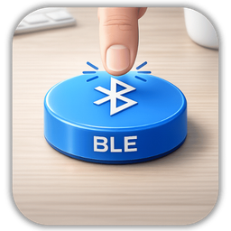
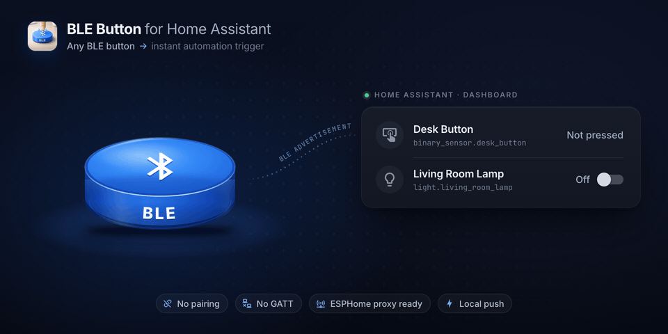
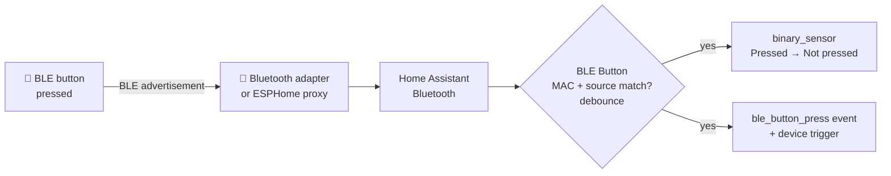

<div align="center">



# BLE Button for Home Assistant

**Turn any cheap Bluetooth LE button into an instant, local Home Assistant trigger.**<br>
No pairing. No GATT connection. No cloud. Just press.

[](https://hacs.xyz/docs/faq/custom_repositories)
[](https://github.com/albert-canfield/ble_button/releases)
[](https://www.home-assistant.io/)
[](https://github.com/albert-canfield/ble_button/actions/workflows/validate.yml)
[](LICENSE)

[](https://my.home-assistant.io/redirect/hacs_repository/?owner=albert-canfield&repository=ble_button&category=integration)

<br>



</div>

---

## Why BLE Button?

Plenty of inexpensive Bluetooth buttons (Aqara and friends) **broadcast an advertisement every time they are pressed**, but many have no Home Assistant integration, or need a vendor hub to work.

BLE Button listens for those broadcasts through the Bluetooth stack Home Assistant already has, so **every adapter and ESPHome Bluetooth proxy in your home becomes a receiver**. A press becomes a clean `binary_sensor` pulse, a device trigger, and an event, ready for automations in under a second.

| | |
|---|---|
| 🔌 **Zero pairing** | Passive listening only. The button is never connected to, so its battery lasts as long as it would on its own. |
| 📡 **Uses your existing Bluetooth** | Local adapters, ESPHome and other Bluetooth proxies. Optionally lock a button to one specific proxy. |
| ⚡ **Local push** | No polling, no cloud, no vendor app. Presses arrive as fast as the advertisement does. |
| 🧩 **Native Home Assistant entities** | A `binary_sensor` that reads **Pressed / Not pressed**, a **Last pressed** timestamp, signal strength, a **Button pressed** device trigger and diagnostics download. |
| 🔍 **Point-and-press setup** | Press the button during setup and pick it from a live list of nearby advertisements. No MAC hunting needed. |
| 🛡️ **Debounced** | Duplicate advertisements from the same press (and from several proxies hearing it) count once. |

## What you get in Home Assistant

Each button you add becomes a **device** with these entities (example name: *Desk Button*):

| Entity | Example ID | What it does |
|---|---|---|
| The button | `binary_sensor.desk_button` | `on` (**Pressed**) for a short pulse (0.6 s by default) on every press, otherwise `off` (**Not pressed**). |
| Last pressed | `sensor.desk_button_last_pressed` | Timestamp of the last press. Kept across restarts. |
| Signal strength | `sensor.desk_button_signal_strength` | RSSI of the last advertisement, in dBm. Diagnostic, **disabled by default**. |

Plus:

- **Device trigger:** *Button pressed*, selectable in the automation editor.
- **Event:** `ble_button_press`, fired on every accepted press.
- **Diagnostics:** listener counters and last-seen details, from *Device → ⋮ → Download diagnostics*.

## Installation

### HACS (recommended)

Click the button below. It opens HACS on your Home Assistant with this repository pre-filled:

[](https://my.home-assistant.io/redirect/hacs_repository/?owner=albert-canfield&repository=ble_button&category=integration)

Or add it by hand:

1. Open **HACS** in Home Assistant.
2. Open the **⋮** menu (top right) → **Custom repositories**.
3. Repository: `https://github.com/albert-canfield/ble_button` · Type: **Integration** → **Add**.
4. Search for **BLE Button** → **Download**.
5. **Restart Home Assistant.**

### Manual

1. Download the latest release from the [releases page](https://github.com/albert-canfield/ble_button/releases).
2. Copy `custom_components/ble_button` into `/config/custom_components/ble_button`.
3. Restart Home Assistant.

> **Requirements:** Home Assistant **2025.1** or newer with the [Bluetooth integration](https://www.home-assistant.io/integrations/bluetooth/) set up, through a local adapter or an [ESPHome Bluetooth proxy](https://esphome.io/components/bluetooth_proxy.html). The integration icon is shown on Home Assistant **2026.3+**.

## Setup

[](https://my.home-assistant.io/redirect/config_flow_start/?domain=ble_button)

**Settings → Devices & services → Add integration → BLE Button**, then choose:

- **Add from recent BLE advertisements**: BLE Button listens for 8 seconds. **Press your button a few times now**; the newest advertisements appear at the top, with the proxy that heard them and their signal strength.
- **Add manually**: enter a name and the button's MAC address (`AA:BB:CC:DD:EE:FF`).

For both you can set:

| Option | Default | Description |
|---|---|---|
| Bluetooth adapter/proxy | Any | Accept presses heard by any adapter, or only by one specific adapter/proxy. |
| Press visible time | `0.6` s | How long the entity stays **Pressed** after each press. |

Both can be changed later from **Configure** on the integration entry.

## Automations

### From the UI (device trigger)

*Settings → Automations → Create automation → Add trigger → **Device*** → pick your button → **Button pressed**.

### YAML: state trigger

```yaml
alias: Desk button toggles the lamp
mode: single
triggers:
  - trigger: state
    entity_id: binary_sensor.desk_button
    to: "on"
actions:
  - action: light.toggle
    target:
      entity_id: light.living_room_lamp
```

### YAML: event trigger

```yaml
alias: Any BLE button press
triggers:
  - trigger: event
    event_type: ble_button_press
    event_data:
      name: Desk Button # optional filter, also: mac, device_id
actions:
  - action: light.toggle
    target:
      entity_id: light.living_room_lamp
```

<details>
<summary><b><code>ble_button_press</code> event data</b></summary>

| Key | Example | Description |
|---|---|---|
| `device_id` | `3f2c…` | Home Assistant device ID of the button |
| `name` | `Desk Button` | Name you gave the button |
| `mac` | `54:EF:44:12:34:56` | Button MAC address |
| `accepted_source` | `any` | Configured adapter/proxy filter |
| `source` | `D8:3A:DD:AA:BB:CC` | Adapter/proxy that heard this press |
| `rssi` | `-67` | Signal strength of this advertisement |
| `path` | `address_callback` | Internal listener that received it |
| `press_count` / `press_id` | `42` | Presses since Home Assistant started |

</details>

## How it works



The advertisement **payload is ignored**. Detection is based on the button's MAC address, optionally narrowed to one adapter/proxy. Advertisements arriving within 150 ms of an accepted press are treated as the same press.

## Troubleshooting

- **Button not in the discovery list:** check that Home Assistant's Bluetooth integration sees advertisements near the button (*Settings → Devices & services → Bluetooth → Advertisement monitor*), and press the button repeatedly while the 8-second scan runs.
- **Presses missed or doubled:** download diagnostics from the device page; the `ignored_*` counters and `last_path` show what the integration received and why it dropped it. Restricting the button to the nearest proxy can help in busy homes.
- **Debug logging:** *BLE Button → ⋮ → Enable debug logging*, press a few times, then disable it to download the log.

## Upgrading from 2.x

Version 3.0 replaces the old text sensor (`none` / `press`) with a proper binary sensor:

| | 2.x | 3.0 |
|---|---|---|
| Entity | `sensor.<name>_press` | `binary_sensor.<name>` |
| States | `none` → `press` → `none` | `off` → `on` → `off` (shown as **Not pressed / Pressed**) |
| Debug attributes | On the entity | *Download diagnostics* |

The old sensor entity is removed automatically. **Update automations** that used `sensor.<name>_press` with `to: "press"` to `binary_sensor.<name>` with `to: "on"`, or switch them to the *Button pressed* device trigger. Automations using the `ble_button_press` event keep working.

## Tested hardware

- Aqara BLE button

Any device that sends a BLE advertisement when pressed should work. If yours does (or doesn't), please [open an issue](https://github.com/albert-canfield/ble_button/issues) so it can be added to this list.

## Development

```bash
python3.14 -m venv .venv && . .venv/bin/activate
pip install -r requirements_test.txt
pytest
```

CI runs Home Assistant's `hassfest`, the HACS validator and the test suite on every push.

## License

[MIT](LICENSE) © Albert Canfield
